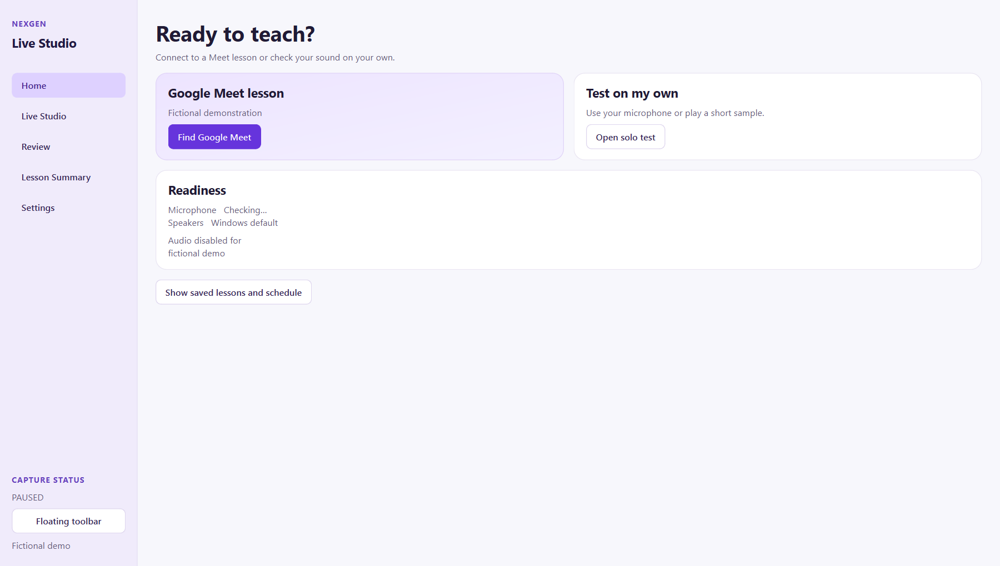

# NexGen Live Studio

A local Windows teaching companion for one-to-one English lessons on Google Meet. Capture the selected Meet tab and the teacher microphone on separate channels, review speaking samples, and prepare an approved report for NexGen.

## Install on Windows

1. Install 64-bit Python 3.12 with the Python launcher. Download or clone this repository and extract it to a writable folder.
2. Double-click **Launch NexGen Live Studio.vbs**. The first launch installs the pinned dependencies and downloads a speech model if needed. Wait for **Transcription ready**. Studio selects a physical microphone and uses the Windows default playback device automatically.
3. For Meet, click **Set up Chrome** once. Studio copies the connector folder path and offers to open Chrome Extensions. Enable **Developer mode**, select **Load unpacked**, paste the folder path, and pin **NexGen Live Studio · Meet Audio**. If you used the original pairing-code connector, load the current folder again. Chrome 116 or newer is required.
4. Optional for a compatible NVIDIA GPU. Run **Install NVIDIA acceleration.cmd**, restart, then choose `large-v3-turbo` or `distil-large-v3` in Settings. The default for new installations is `base.en` on CPU, with automatic CUDA selection when available. A compatible existing NexGen Analyzer model cache is reused when present next to this project.

Open a visual walkthrough without capturing audio with `wscript "Launch NexGen Live Studio.vbs" --demo`. The demo uses a temporary fictional lesson database.

## Test on my own

Choose **Open solo test** from Home. Click **Start microphone test**, say one English sentence and pause briefly to see the transcript. Click **Stop mic test** when done. **Play a test sentence** plays a synthetic sentence through Windows and transcribes the original sample independently of your microphone. Solo test text stays in memory and needs no Meet call or student.

## Teach a lesson

1. Open your Google Meet call in Chrome. Studio finds open Meet tabs and **Connect Meet** brings the selected one forward. Click the pinned Live Studio icon to allow audio on that tab. Chrome requires that action for tab capture.
2. In Studio, choose or enter the learner, confirm recording consent, and select **Start recording**. Use the solo test for your own speech when there is no second participant.
3. Use **F8** to pause or resume and **F9** to finish the sample. **Space** and **V** work in the focused workspace outside text controls. **Options** lets you select an activity or use **Transcript only**.
4. In **Review**, correct what recognition got wrong in **What was said**. Put teaching wording in **Teaching correction**. Mark teacher-assisted speech or unclear evidence, and separately confirm grammar constructions and tracked error counts. Add vocabulary in the Teaching Board and explicitly share selected items in the student presentation.
5. In **Lesson Summary**, inspect each sample and the combined evidence. Select the outcome and approve, then export the report. **Export for Review Studio** creates the legacy import file. Select the matching reservation in the existing NexGen Review Studio and verify the student identity there before importing.

[Teacher guide](docs/teacher-guide.md) · [Integration contract](docs/integration.md) · [Verification and benchmarks](docs/verification.md)

## Screens

[Home](docs/screens/lesson-desk.png) · [Solo test](docs/screens/solo-test.png) · [Live Studio](docs/screens/live-studio.png) · [Transcript review](docs/screens/transcript-review.png) · [Lesson summary](docs/screens/lesson-summary.png) · [Student presentation](docs/screens/student-presentation.png)

## Current integration and acceptance

Local operation, the Chrome capture bridge and report exports are implemented. A live two-person Google Meet lesson, naturally accented learner speech, acoustic playback, hardware switching during a real call, and production reservation and sync access still need acceptance. The app starts in local mode. An explicitly configured HTTPS service using the [integration contract](docs/integration.md) can supply reservations and accept approved results. Google Calendar and production NexGen access are not connected.

Live Studio keeps session evidence in the current Windows user's local app data. Raw audio is processed in memory. Presentation shows only the open student's shared material and approved evidence. Pace and language counts are observations, and the teacher owns the lesson outcome.
