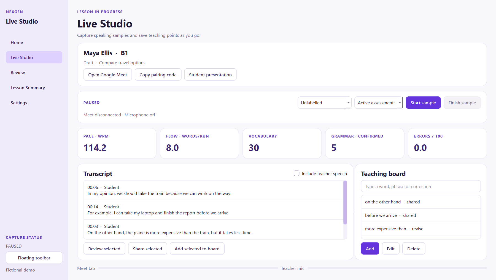

# NexGen Live Studio

A local Windows teaching companion for one-to-one English lessons on Google Meet. Capture the selected Meet tab and the teacher microphone on separate channels, review speaking samples, and prepare an approved report for NexGen.

## Install on Windows

1. Install 64-bit Python 3.12 with the Python launcher. Download or clone this repository and extract it to a writable folder.
2. Double-click **Launch NexGen Live Studio.vbs**. The first launch installs the pinned dependencies. In **Settings**, select **Download / load model** if the local model is unavailable. Later launches use the local cached model.
3. In Chrome, open `chrome://extensions`, enable **Developer mode**, select **Load unpacked**, and choose the repository's `extension` folder. Pin **NexGen Live Studio · Meet Audio**. Chrome 116 or newer is required.
4. Optional for a compatible NVIDIA GPU. Run **Install NVIDIA acceleration.cmd**, restart, then choose `large-v3-turbo` or `distil-large-v3` in Settings. The default for new installations is `base.en` on CPU, with automatic CUDA selection when available. A compatible existing NexGen Analyzer model cache is reused when present next to this project.

Open a visual walkthrough without capturing audio with `wscript "Launch NexGen Live Studio.vbs" --demo`. The demo uses a temporary fictional lesson database.

## Teach a lesson

1. In **Home**, open a matching reservation or start an unscheduled lesson. Confirm the student's stable ID and name, and obtain recording consent. Use headphones for the clearest channel separation.
2. Open the call. In Live Studio choose **Copy pairing code**. On the intended Meet tab, open the Chrome extension, paste the code and select **Connect this tab**. Check both audio channels in Live Studio.
3. Choose an activity if useful, then select **Start sample**. Use **F8** to pause or resume and **F9** to finish the sample. **Space** and **V** work in the focused workspace outside text controls. Switch to **Transcript only** when the speech should stay outside assessment.
4. In **Review**, correct what recognition got wrong in **What was said**. Put teaching wording in **Teaching correction**. Mark teacher-assisted speech or unclear evidence, and separately confirm grammar constructions and tracked error counts. Add vocabulary in the Teaching Board and explicitly share selected items in the student presentation.
5. In **Lesson Summary**, inspect each sample and the combined evidence. Select the outcome and approve, then export the report. **Export for Review Studio** creates the legacy import file. Select the matching reservation in the existing NexGen Review Studio and verify the student identity there before importing.

[Teacher guide](docs/teacher-guide.md) · [Integration contract](docs/integration.md) · [Verification and benchmarks](docs/verification.md)

## Screens

[Lesson desk](docs/screens/lesson-desk.png) · [Transcript review](docs/screens/transcript-review.png) · [Lesson summary](docs/screens/lesson-summary.png) · [Student presentation](docs/screens/student-presentation.png)

## Current integration and acceptance

Local operation, the Chrome capture bridge and report exports are implemented. A live two-person Google Meet lesson, naturally accented learner speech, acoustic playback, hardware switching during a real call, and production reservation and sync access still need acceptance. The app starts in local mode. An explicitly configured HTTPS service using the [integration contract](docs/integration.md) can supply reservations and accept approved results. Google Calendar and production NexGen access are not connected.

Live Studio keeps session evidence in the current Windows user's local app data. Raw audio is processed in memory. Presentation shows only the open student's shared material and approved evidence. Pace and language counts are observations, and the teacher owns the lesson outcome.
